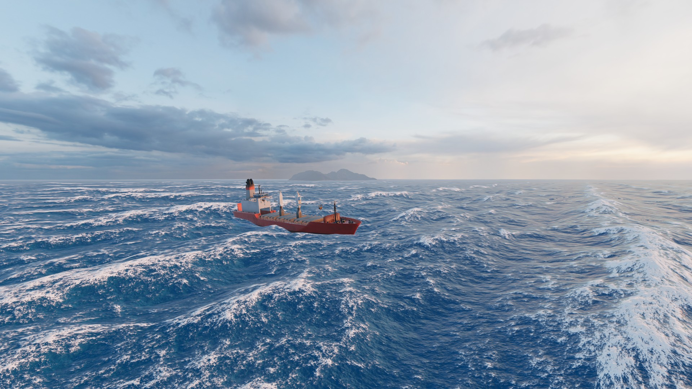
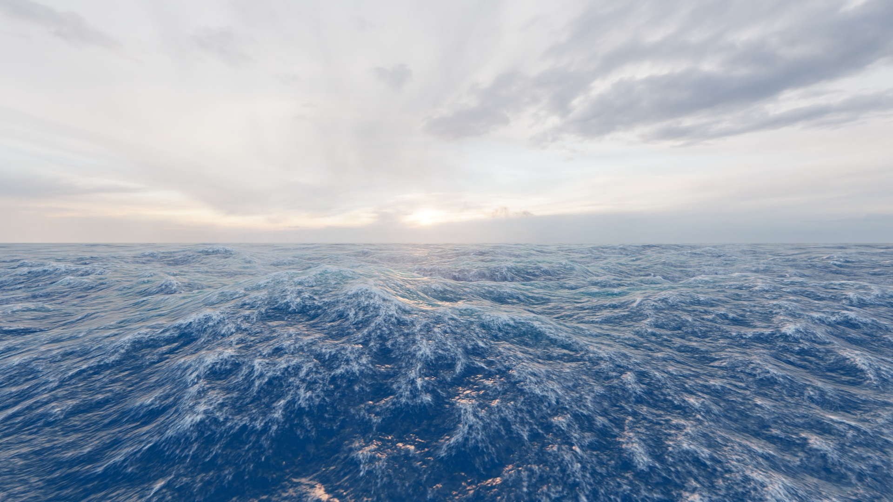

# HydroGL

HydroGL is a modern OpenGL 3D ocean simulation project.

## Features

- Implementation of the Tessendorf method for free surface simulation, including the following enhancements to the original paper:
  - empirical spectrum (JONSWAP),
  - directional spread,
  - cascades,
  - water velocity calculations,
- simulation of the influence of buoyancy and drag forces on floating objects,
- simulation of dynamic waves created by floating objects,
- water foam mask,
- spray particle system implemented entirely on the GPU,
- subsurface scattering calculations,
- refraction and absorption calculations,
- LOD system using geomorphing,
- 3D rendering engine:
  - PBR materials,
  - image-based lighting,
  - cascading shadow matrices,
  - directional lights, point lights and spotlights.

|  |  |
|---------------------------------------------------------------|------------------------------------------------------------------------|

## Showcase video

[](https://youtu.be/s60CJzEqQ9E)  
<https://youtu.be/s60CJzEqQ9E>

## Requirements

This project only works on Windows systems (tested on Windows 10 and 11).

The executable is provided in the Releases section.

Building the project requires:

- CMake 3.31+,
- Microsoft Visual Studio toolset (tested with MSVC 17.14.26).

## Building the project

To build the project, clone the repository using:

```powershell
git clone 'https://github.com/kacper119p/HydroGL.git'
```

Enter the cloned repository's root folder:

```powershell
cd .\HydroGL\
```

Run the following commands to build the project (assumes `cmake.exe` is in the `PATH`):

```powershell
cmake.exe -B $BuildDirectoryName
cmake.exe --build $BuildDirectoryName --config Release # or Debug
```

You can also use the IDE of your choice. Most IDEs will autodetect the CMake project and provide options to configure and build it.

## Performance

The sample scene renders in 4.6-7.2 ms depending on the camera's position and orientation on a computer with an NVIDIA GeForce RTX 5070 Ti and an AMD Ryzen 7 9800X3D.

## Dependencies

- In the ThirdParty folder:
  - [Glad](https://github.com/Dav1dde/glad),
  - [Boost](https://www.boost.org/) (chosen modules),
  - [Wgl](https://registry.khronos.org/OpenGL/api/GL/),
- managed by [CPM](https://github.com/cpm-cmake/CPM.cmake):
  - [Dear ImGui](https://github.com/ocornut/imgui),
  - [glm](https://github.com/g-truc/glm/tree/master),
  - [spdlog](https://github.com/gabime/spdlog/tree/master),
  - [EnTT](https://github.com/skypjack/entt/tree/main),
  - [assimp](https://github.com/assimp/assimp),
  - [Jolt Physics](https://github.com/jrouwe/JoltPhysics/tree/master),
  - [googletest](https://github.com/google/googletest/tree/main),
- [OpenGL](https://www.opengl.org/).
